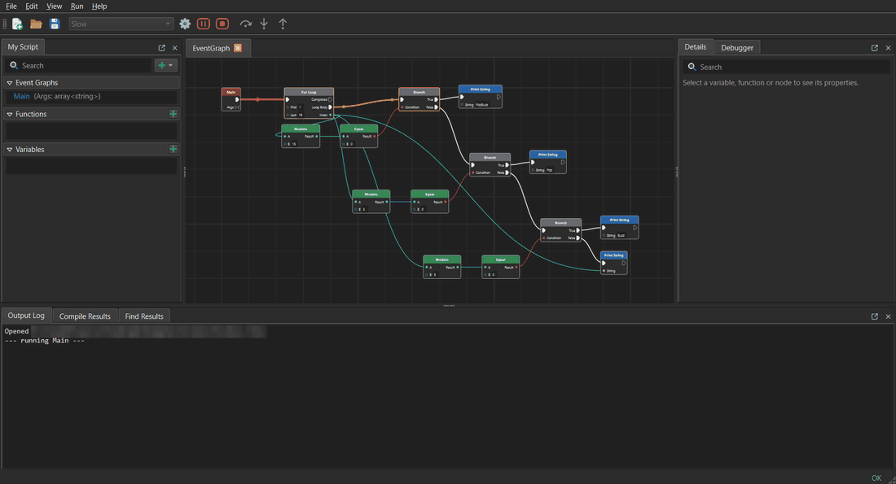
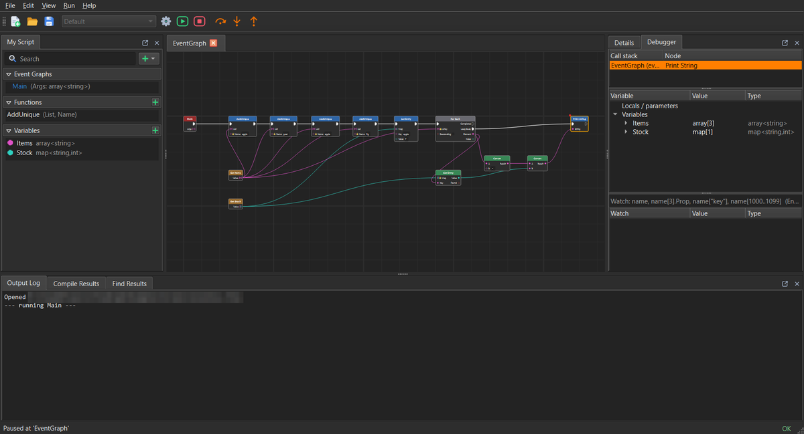
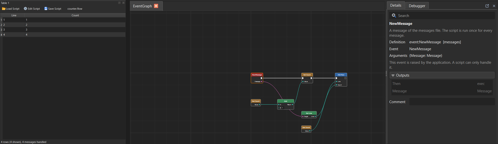

# FlowGraph

**Visual scripting for C++ applications**, in the style of Unreal's Blueprints. Users build scripts as node graphs in an
editor and debug them step by step; your application runs them in a small interpreter, and they call your own C++ classes.



* **Made to be embedded.** The runtime is a C++20 library with no Qt in it: load, check and run scripts, make your classes,
  functions and events available to them. Scripts can also run on a worker thread, so your application never waits for them.
* **A real debugger.** Breakpoints, step over / into / out, the call stack, the script's variables and watches, values shown
  when you hover a pin - also on a script your application is running right now.
* **Ready to use on its own.** `flow script.flow` runs a script from the command line, like `python script.py`; `flowstudio`
  edits, runs and debugs it.
* **Safe with scripts users write.** Every script is checked against what the application provides before it runs. Limits keep a
  script you do not trust from running away, and a changed script can be reloaded while the application runs.
* **Extensible.** Plugins add classes, functions, enums and nodes; a plugin built for another version is refused, not run.
  The **FileSystem** plugin comes with it: open, read and write files; copy, move, list and delete files and folders.
* **In 10 languages.** The editor speaks English, Persian, Chinese, Spanish, German, Japanese, Portuguese, French, Russian and
  Korean (most of them machine translations: reviews are welcome).



## Try it

Download the package for Windows or Linux from [Releases](https://github.com/MehrabiManaf/FlowGraph/releases) and unzip it. Start
`bin/flowstudio`, open `examples/fizzbuzz.flow` (*File > Open*) and press **F5**: *Run > Execution speed* slows the run down
so you can follow it. In a terminal, `bin/flow examples/fizzbuzz.flow` runs the same script without the editor.

On Linux the package runs on distributions with glibc 2.28 or newer: RHEL / CentOS / Alma / Rocky 8 and 9, Debian 10, Ubuntu
20.04 and newer. `flowstudio` uses the system's X11 libraries, and Qt 6 needs `xcb-util-cursor` among them (RHEL family, from
EPEL: `dnf install xcb-util-cursor`; Debian / Ubuntu: `apt install libxcb-cursor0`). `flow` needs none of them.

## Put it in your application

```cpp
#include <FlowGraph/Runtime.hpp>

fg::Runtime rt;
rt.registry().addEvent("Tick", {{"DeltaTime", "float"}});                          // what your application raises
rt.registry().addFunction("Game.Log", [](const std::string& s) { puts(s.c_str()); }, {"Text"});   // what scripts may call

auto loaded = rt.loadScript("level.flow");                                         // read, and check it fits this application
auto program = rt.compile(loaded.script);
fg::Instance instance(program);
instance.callEvent("Tick", {0.016});
```

Your users get the same editor as `flowstudio`: `fged::ScriptEditor` is a class your Qt application creates, with an
`EditorHost` that tells it what *Run* means in your application. The [embedded example](Examples/Embedded) is a complete one:
an application whose tables are filled by scripts, edited and debugged while it runs. **[Docs/Embedding.md](Docs/Embedding.md)**
has the rest: your classes as nodes, plugins, limits for scripts you do not trust, hot reload, running without blocking, the
editor's modes.



**Licenses:** the runtime and `flow` are **MIT**, so they can go into any application, closed source included. The editor and
`flowstudio` are **GPL-3.0** (they are built on KDDockWidgets), so an application that embeds the editor is GPL too. See
[License](#license).

## The pieces

```
 your application                                           standard applications
 ┌──────────────────────────────┐                           ┌───────────────────────────────┐
 │ runtime only                 │  FlowGraphCore            │ flow         runs a script    │
 │   load / check / run scripts │  (no Qt)                  │ flowstudio   edit, run, debug │
 ├──────────────────────────────┤                           └───────────────────────────────┘
 │ + Executor / AsyncExecutor   │  non-blocking execution       both raise only one event:
 ├──────────────────────────────┤                               Main(Args: array<string>)
 │ + ScriptEditor (library)     │  FlowGraph::ScriptEditor
 └──────────────────────────────┘  (Qt 6 + KDDockWidgets)
```

* **Runtime** (`Core/`): types and reflection, compiler, interpreter, debugger, built-in nodes, plugins. An application
  that only needs to *run* scripts links only this.
* **Executor / AsyncExecutor** (`Core/`): run scripts without blocking the host.
* **ScriptEditor** (`Editor/`): the editor as a library, for applications that let their users create, change, run and debug
  scripts.
* **flow** and **flowstudio** (`Apps/`): the *standard applications*. Their only event is `Main(Args: array<string>)` and scripts
  may end them with the **Exit** node.
* **FileSystem** (`Plugins/FileSystem/`): the plugin for files and folders, loaded by `flow` and `flowstudio`.

Also: `Examples/` (sample scripts and the embedded example), `Tests/`, `Docs/`.

## Build

Windows with MSVC 2022, or Linux with GCC 13; Qt 6.9 for the editor (`QT_DIR` names the Qt kit):

```
git submodule update --init
cmake --preset windows-release      # or linux-release; core-only: the runtime and flow, without Qt
cmake --build --preset windows-release
ctest --preset windows-release
```
The programs are in `build/<preset>/bin`. `FG_BUILD_EDITOR`, `FG_BUILD_TESTS`, `FG_BUILD_EXAMPLES` and `FG_BUILD_PLUGINS` switch
parts off. To use FlowGraph from another CMake project, install it and `find_package(FlowGraph)`: see
[Docs/Embedding.md](Docs/Embedding.md#building-against-flowgraph).

## flow and flowstudio

`flow script.flow [arguments...]` runs a script: its `Main` event gets the arguments, the **Exit** node gives the exit code. It
loads the plugins in the `plugins` folder next to it and in `FLOW_PLUGIN_PATH`; `flow --help` lists its options.

`flowstudio [script.flow]` edits, runs and debugs a script. What *Run* does (arguments, working directory, environment,
plugins) is kept in **launch configurations** next to the script (`script.flowlaunch`, *Run > Launch Configurations...*).

**[Docs/Scripting.md](Docs/Scripting.md)** has the keys of the editor, the launch configurations, `flow`'s options, how the
nodes behave and the FileSystem plugin; **[Docs/NodeReference.md](Docs/NodeReference.md)** lists every built-in node.

## Languages

*View > Language* chooses the language of the editor and of the nodes (it applies at the next start). Only texts change - the
layout stays left to right - and scripts do not depend on the language: a script made in one language opens unchanged in any
other. Persian is reviewed; the other languages are machine translations waiting for a native speaker, and corrections are
welcome (see [CONTRIBUTING.md](CONTRIBUTING.md#translations)).

## License

FlowGraph has two licenses; `LICENSE` lists which part has which, and every source file names its own in an SPDX line.

| Part | License |
|-|-|
| `Core/` (FlowGraphCore), `Apps/Flow/` (`flow`), `Plugins/FileSystem/`, the tests, tools and build files | **MIT** (`LICENSES/MIT.txt`) |
| `Editor/` (FlowGraphEditor, the ScriptEditor library), `Apps/Studio/` (`flowstudio`), `Examples/Embedded/` | **GPL-3.0-only** (`LICENSES/GPL-3.0.txt`) |

The runtime can be used in any application, closed source included, and plugins may have any license. The editor is GPL
because it is built on KDDockWidgets (GPL-2.0-only or GPL-3.0-only, `ThirdParty/KDDockWidgets`): an application that embeds
the editor is a work based on GPL code. Qt, which only the editor uses, is used under the LGPL-3.0 (`LICENSES/LGPL-3.0.txt`).

## About

FlowGraph is developed by Abdolmanaf Mehrabi Sisakht, with the assistance of AI tools, which supported the coding process,
debugging and problem-solving.
